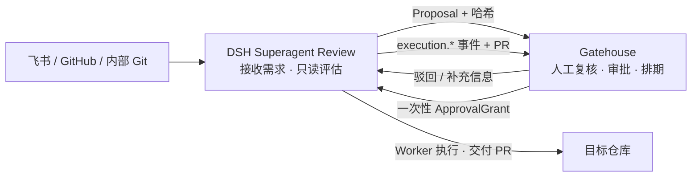

<p align="center">
  
</p>

<h1 align="center">Gatehouse</h1>

<p align="center">
  <strong>AI 负责评估，人负责决策；批准之后，才进入真实交付。</strong>
</p>

<p align="center">
  Gatehouse 是面向 <a href="https://github.com/AIR-DUSTER1/dsh-superagent-review">DSH Superagent Review</a> 的人工复核、审批、排期、执行授权与审计控制台。
</p>

<p align="center">
  <a href="https://github.com/AIR-DUSTER1/dsh-gatehouse"></a>
  
  
  
  
  
  
</p>

## 目录

- [项目简介](#项目简介)
- [工作流](#工作流)
- [核心功能](#核心功能)
- [技术架构](#技术架构)
- [快速开始](#快速开始)
- [配置说明](#配置说明)
- [接入工作区与仓库](#接入工作区与仓库)
- [接入-dsh-superagent-review](#接入-dsh-superagent-review)
- [使用流程](#使用流程)
- [生产部署](#生产部署)
- [项目结构](#项目结构)
- [安全边界](#安全边界)
- [常见问题](#常见问题)
- [参与贡献](#参与贡献)
- [相关仓库与来源](#相关仓库与来源)
- [许可证](#许可证)

## 项目简介

自动化编码最危险的一步，不是让 Agent 写代码，而是让它在没有人工确认的情况下直接修改真实仓库。

Gatehouse 位于“评估”和“执行”之间，把 Agent 的 Proposal 变成一条可审计、可控制、不可越权重放的交付流程：

- 需求先由 DSH Superagent Review 做只读评估，生成 Proposal。
- 人在 Gatehouse 中查看范围、风险、影响和测试计划，再决定批准、驳回或要求补充。
- 批准会绑定需求哈希、范围哈希和有效期，并生成一次性 `ApprovalGrant`。
- 只有到达排期时间且 Grant 校验通过后，执行侧才可以创建 Worker、修改仓库并提交 PR。
- 执行回执、PR、失败原因和完整审批链最终回到 Gatehouse，形成统一审计视图。

Gatehouse 不直接操作 Git，不创建 worktree，也不代替执行侧合并 PR。

## 工作流



整个过程中，审批决定与外部插件调用通过 transactional outbox 解耦，数据库事务内不会直接执行网络副作用。

## 核心功能

| 能力 | 说明 |
| --- | --- |
| 人工复核 | 查看需求、范围、风险、规则命中和测试计划；审批意见支持选填 |
| 版本绑定 | Approval 绑定 `requirement_hash`、`scope_hash` 与有效期；内容变化后旧批准自动失效 |
| 排期控制 | 支持排期、暂停、恢复、改期、撤回和失败重试；改期会同步更新执行授权 |
| 一次性授权 | Grant 只能原子消费一次；重放、重复执行和过期授权都会被拒绝 |
| 执行投影 | 展示执行中、已完成、失败、PR 链接和失败原因，不把“已触发”误报为“已完成” |
| 多工作区隔离 | 任务、仓库、成员、排期、授权和审计按工作区隔离，避免跨仓库混单 |
| 用户与角色 | 一次性邀请、账号启停、密码重置、自定义角色和权限矩阵 |
| 可靠事件 | HMAC、timestamp、nonce、idempotency key、重试和 outbox 保证事件幂等 |
| 审计与统计 | Append-only 审计记录，以及跨工作区的交付、风险和工作区统计 |
| Provider 边界 | GitHub 支持原生事件轮询；其他 Git 平台可接入为执行目标，不伪造未实现能力 |

## 技术架构

| 层级 | 技术 | 职责 |
| --- | --- | --- |
| Web | React 19、Vite 7、Ant Design 6、ECharts 6 | 工作台、复核、排期、执行记录、审计、用户与角色管理 |
| API | Fastify 5、TypeScript、Zod 4 | HTTP 协议、鉴权、权限校验、事件接入和管理 API |
| Domain | TypeScript | 审批、Grant、排期、工作区、用户、角色和审计规则 |
| Data | SQLite、`node:sqlite` | 业务数据、事件幂等、排期状态和 transactional outbox |
| Contract | Zod、JSON Schema、HMAC | 前后端共享类型、插件事件协议和签名校验 |
| Web UI | Ant Design 6 + 项目共享组件 | 统一布局、状态反馈、窄屏适配和高风险操作确认 |

## 快速开始

### 环境要求

- Node.js **22 或更高版本**
- pnpm **12.5.1**
- Git
- 可选：DSH Superagent Review 插件与可访问的 Git Provider

### 1. 获取代码并安装依赖

```bash
git clone https://github.com/AIR-DUSTER1/dsh-gatehouse.git
cd dsh-gatehouse

corepack enable
corepack prepare pnpm@12.5.1 --activate
pnpm install
```

如果本机已经安装 pnpm 12.5.1，可以跳过 Corepack 命令。

### 2. 创建本地配置

Windows PowerShell：

```powershell
Copy-Item .env.example .env
```

macOS / Linux：

```bash
cp .env.example .env
```

首次启动前，至少修改以下配置：

```dotenv
SESSION_SECRET=replace-with-a-long-random-secret
PLUGIN_EVENT_SECRET=replace-with-another-long-random-secret
PLUGIN_SHARED_SECRET=replace-with-plugin-shared-secret

BOOTSTRAP_ADMIN_EMAIL=admin@example.com
BOOTSTRAP_ADMIN_NAME=Gatehouse Admin
BOOTSTRAP_ADMIN_PASSWORD=replace-with-at-least-12-characters
```

数据库为空时，Gatehouse 只创建这一个初始管理员。密码至少 12 位。

### 3. 启动开发环境

```bash
pnpm dev
```

启动后访问：

| 服务 | 地址 |
| --- | --- |
| Web 控制台 | <http://127.0.0.1:5173> |
| API | <http://127.0.0.1:8787> |
| 健康检查 | <http://127.0.0.1:8787/health> |
| 就绪检查 | <http://127.0.0.1:8787/ready> |

本地开发可以使用 `PLUGIN_MODE=mock` 验证控制台流程。真实交付必须切换为 `PLUGIN_MODE=http`，并连接正在运行的 DSH Superagent Review。

## 配置说明

完整配置见 [.env.example](./.env.example)。生产环境建议只通过环境变量或密钥管理系统注入敏感值。

| 变量 | 默认值 | 说明 |
| --- | --- | --- |
| `HOST` | `127.0.0.1` | API 监听地址；反向代理部署时按网络边界设置 |
| `PORT` | `8787` | API 监听端口 |
| `DATABASE_PATH` | `./data/console.db` | SQLite 数据库路径；需持久化并定期备份 |
| `WEB_ORIGIN` | `http://127.0.0.1:5173` | 允许访问 API 的 Web Origin |
| `SESSION_SECRET` | 开发默认值 | 用户会话签名密钥；生产必须替换 |
| `PLUGIN_MODE` | `mock` | `mock` 仅用于开发；生产使用 `http` |
| `PLUGIN_BASE_URL` | `http://127.0.0.1:8790` | DSH Superagent Review 服务地址 |
| `PLUGIN_EVENT_SECRET` | 开发默认值 | 校验插件事件 HMAC；生产必须替换 |
| `PLUGIN_SHARED_SECRET` | 开发默认值 | Gatehouse 调用执行侧时使用；生产必须替换 |
| `SCHEDULE_POLL_MS` | `1000` | 持久化排期扫描间隔 |
| `SCHEDULE_MAX_CONCURRENCY` | `2` | 同时触发的最大执行数 |
| `PLUGIN_TIMEOUT_MS` | `5000` | 单次插件调用超时 |
| `PLUGIN_MAX_ATTEMPTS` | `5` | outbox 最大投递次数 |
| `BOOTSTRAP_ADMIN_*` | 空 | 空数据库首次启动时使用的初始管理员 |
| `REPOSITORY_HOST_ALLOWLIST` | 空 | 允许接入的 Git 主机列表，逗号分隔 |
| `ALLOW_PRIVATE_REPOSITORY_HOSTS` | `false` | 是否允许接入显式允许的私网 Git 主机 |

生成高熵密钥：

```powershell
[Convert]::ToBase64String([Security.Cryptography.RandomNumberGenerator]::GetBytes(48))
```

或：

```bash
openssl rand -base64 48
```

## 接入工作区与仓库

1. 使用初始管理员登录 Gatehouse。
2. 打开“工作区与仓库”，创建工作区。
3. 填写 Provider、仓库标识、访问地址和凭据引用。
4. Gatehouse 请求 DSH 执行只读连通性检查，并生成仓库描述建议。
5. 管理员确认描述后，配置会同步给 DSH，后续任务即可路由到该仓库。

凭据字段只接受：

```text
env:NAME
file:PATH
```

Gatehouse 不保存明文 Token。Git Push 和 PR 交付使用 DSH 运行账户已有的 Git 凭据。

私仓环境需要显式配置主机允许列表：

```dotenv
REPOSITORY_HOST_ALLOWLIST=github.com,git.internal.example
ALLOW_PRIVATE_REPOSITORY_HOSTS=true
```

## 接入 DSH Superagent Review

Gatehouse 与 [DSH Superagent Review](https://github.com/AIR-DUSTER1/dsh-superagent-review) 使用同一组事件与命令密钥。

Gatehouse `.env`：

```dotenv
PLUGIN_MODE=http
PLUGIN_BASE_URL=http://127.0.0.1:3082
PLUGIN_EVENT_SECRET=<与 consoleEventSecret 相同>
PLUGIN_SHARED_SECRET=<与 consoleSharedSecret 相同>
```

DSH profile 的 `cordis.patch.yml`：

```yaml
- id: dsh-superagent
  config:
    stateDir: <absolute state directory>
    consoleUrl: http://127.0.0.1:8787
    consoleEventSecret: <event secret>
    consoleSharedSecret: <command secret>
```

事件签名、幂等、审批决策、Grant、改期、撤回和执行回执的完整契约见 [插件集成文档](./docs/plugin-integration.md)。

## 使用流程

### 复核 Proposal

进入工作区的“复核中心”，打开待处理需求，核对：

- 需求原文和调研结论
- 影响范围与需求哈希
- 风险等级和风险原因
- 测试计划与预计成本
- 目标工作区和仓库

批准时可以填写排期时间，也可以直接批准进入待排期状态。审批意见不是必填项。

### 控制排期

“执行调度”按状态展示待执行、执行中、已完成、异常和已撤回记录。管理员可以：

- 暂停或恢复待执行排期
- 修改排期时间并同步新的 Grant
- 撤回排期并吊销旧授权
- 重试因 outbox 失败的执行同步

排期时间是开发开始时间，不是完成时间。执行后仍需经过测试、部署和交付验证。

### 查看交付与审计

“交付记录”展示执行状态、PR 和失败原因；“审计日志”保留审批、排期、执行和状态变化的完整链路。

## 生产部署

1. 设置生产环境变量并替换全部开发默认密钥。
2. 执行构建：

```bash
pnpm build
```

3. 启动 API：

```bash
pnpm start
```

4. 将 `apps/web/dist` 部署为静态站点。
5. 使用同源反向代理把 `/api/*`、`/health` 和 `/ready` 转发到 Gatehouse API。

建议的生产约束：

- 全站启用 HTTPS。
- `WEB_ORIGIN` 设置为真实前端 Origin。
- SQLite 数据库目录使用持久卷；停机后备份 `.db`、`-wal` 和 `-shm`，或使用 SQLite 在线备份 API。
- 插件与 API 端口只允许可信网络访问。
- 定期轮换会话密钥和插件密钥。
- 监控 `/health` 与 `/ready`，并对 `pending_outbox` 持续增长告警。

## 项目结构

```text
apps/
  server/src/             Fastify API、领域服务、SQLite 仓储、调度器和插件适配器
  server/tests/           服务端单元与集成测试
  web/src/                React 控制台、页面、组件、API 客户端和样式
  web/tests/              Web 单元测试
packages/
  contract/               前后端共享类型、Zod schema、签名与事件协议
docs/
  architecture.md         系统职责、边界、一致性和高可用设计
  approval-flow.md        人工复核与审批流程
  plugin-integration.md   Gatehouse 与执行侧的完整协议
  data-model.md           数据实体、状态机和审计模型
  acceptance-checklist.md 验收与交付检查项
scripts/                  浏览器冒烟、Git hooks 和提交信息校验
```

## 安全边界

- 人工批准前，不创建 Ticket、worktree、分支或 PR。
- Approval 绑定需求哈希、范围哈希和过期时间。
- `ApprovalGrant` 只能消费一次，重放请求必须被拒绝。
- 插件请求必须校验 HMAC、timestamp、nonce 和 idempotency key。
- 权限必须由服务端再次校验，不能只依赖前端隐藏按钮。
- 审计记录保持 append-only，纠错通过新增审计事件完成。
- 外部网络副作用只能由 outbox 投递，不能在数据库事务中直接执行。
- 不在仓库、日志或数据库明文字段中保存密钥、Token 和真实凭据。

## 常见问题

| 问题 | 处理方式 |
| --- | --- |
| 首次启动提示没有用户 | 配置 `BOOTSTRAP_ADMIN_EMAIL`、`BOOTSTRAP_ADMIN_NAME` 和至少 12 位密码 |
| 页面能打开但 API 请求失败 | 检查 API 端口、`WEB_ORIGIN` 和 Vite / 反向代理配置 |
| 审批后一直未执行 | 检查排期时间、Grant 状态、`/ready` 的 `pending_outbox` 和执行器日志 |
| 仓库健康检查失败 | 检查仓库地址、凭据引用、网络 / TLS 和主机允许列表 |
| 改期后旧授权仍存在 | 不应发生；检查改期事务是否完成并对照审计记录 |

## 参与贡献

问题报告请使用 [GitHub Issues](https://github.com/AIR-DUSTER1/dsh-gatehouse/issues)，并尽量提供：

- 复现步骤
- 预期行为与实际行为
- 环境与版本
- 相关日志中的 `trace_id`
- 已脱敏的截图或网络请求

代码、测试、分支、提交和评审规范统一见 [AGENTS.md](./AGENTS.md)。

## 相关仓库与来源

- [Gatehouse](https://github.com/AIR-DUSTER1/dsh-gatehouse)：人工复核、审批、排期、执行投影与审计控制台。
- [DSH Superagent Review](https://github.com/AIR-DUSTER1/dsh-superagent-review)：需求接收、只读评估、Proposal、Grant 校验、Worker 执行与 PR 交付。

DSH Superagent Review 来源于开源项目 **dsh-superagent**：

<https://github.com/deepseek-ai/dsh-superagent-prototype>

Gatehouse 不是 DeepSeek 官方产品，也不代表 DeepSeek 官方立场。

## 许可证

Gatehouse 仓库当前尚未添加根目录 `LICENSE` 文件。若计划公开分发、商业使用或接受外部代码贡献，请先由维护者确定并补充许可证。
